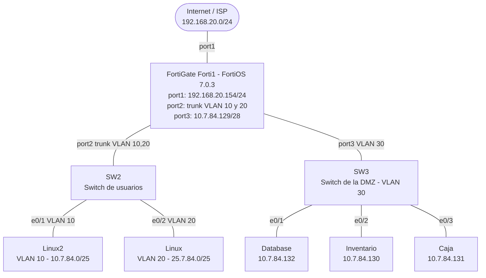
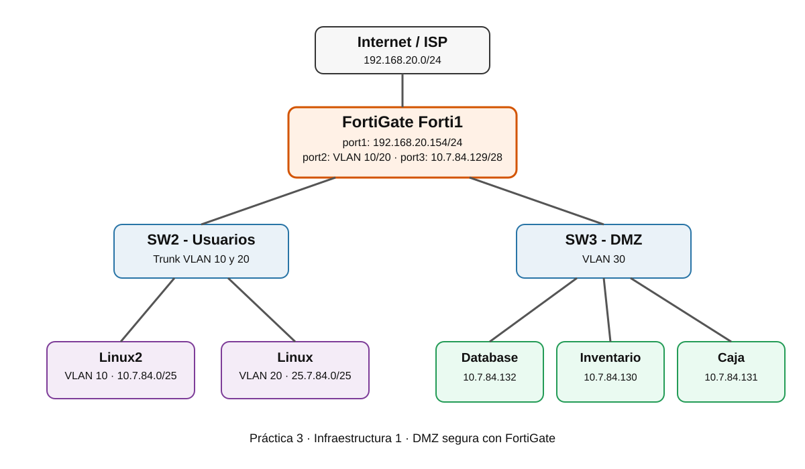
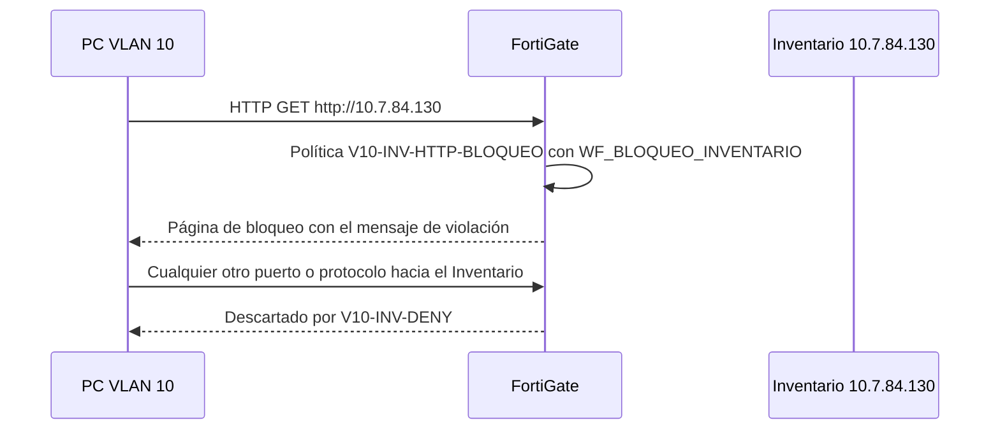
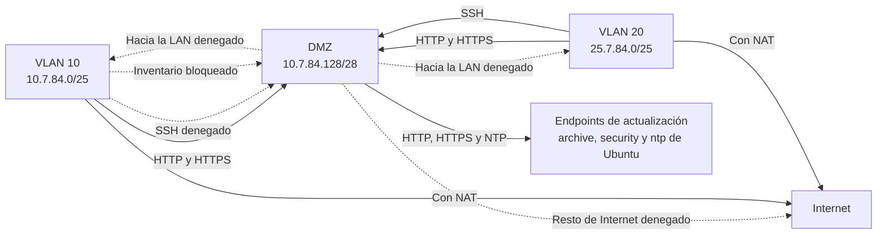

# Práctica 3 - Infraestructura 1: DMZ segura con FortiGate

## Video demostrativo

| Parte | Enlace |
|---|---|
| Parte 1 | [Ver video demostrativo - Parte 1](https://itlaedudo-my.sharepoint.com/:v:/g/personal/20250784_itla_edu_do/IQBqhjXTr22iS7EDCVt8UwaCAU9d2e-9HeK4ea0HhRyB470?e=msIrau&nav=eyJyZWZlcnJhbEluZm8iOnsicmVmZXJyYWxBcHAiOiJTdHJlYW1XZWJBcHAiLCJyZWZlcnJhbFZpZXciOiJTaGFyZURpYWxvZy1MaW5rIiwicmVmZXJyYWxBcHBQbGF0Zm9ybSI6IldlYiIsInJlZmVycmFsTW9kZSI6InZpZXcifX0%3D) |
| Parte 2 | [Ver video demostrativo - Parte 2](https://itlaedudo-my.sharepoint.com/:v:/g/personal/20250784_itla_edu_do/IQB3E7wXR6_ZQoxP8yTSMjNzAZffVGRTNJVji-jLmWhWEAU?e=MVmTqM&nav=eyJyZWZlcnJhbEluZm8iOnsicmVmZXJyYWxBcHAiOiJTdHJlYW1XZWJBcHAiLCJyZWZlcnJhbFZpZXciOiJTaGFyZURpYWxvZy1MaW5rIiwicmVmZXJyYWxBcHBQbGF0Zm9ybSI6IldlYiIsInJlZmVycmFsTW9kZSI6InZpZXcifX0%3D) |

## Datos del estudiante

| Campo | Detalle |
|---|---|
| Estudiante | Rafael Andres Reyes De La Cruz |
| Matrícula | 2025-0784 |
| Materia | Seguridad de Redes |
| Profesor | Jonatan Rondon |
| Repositorio | https://github.com/andreskm45-source/Practica3-infraestructura1-DMZ |

## Propósito del laboratorio

Diseñar, implementar y validar en PNETLab una infraestructura de red segmentada que protege un grupo de servidores mediante una zona desmilitarizada (DMZ) controlada por un firewall FortiGate configurado exclusivamente por interfaz gráfica (GUI).

Objetivos:

- Ubicar los servidores de Caja, Inventario y Base de Datos en una DMZ independiente de la red LAN de usuarios.
- Aplicar políticas de firewall que eviten la fuga de tráfico desde la DMZ hacia la LAN.
- Impedir que la DMZ tenga acceso abierto a Internet, permitiéndole únicamente los endpoints de actualización de los servicios utilizados.
- Permitir el acceso SSH a los servidores solo desde la VLAN 20.
- Restringir a la VLAN 10 el acceso al Sistema de Inventario, mostrando al usuario una página que le indique la violación de la política.
- Segmentar a los usuarios en VLAN con asignación de direcciones por DHCP y aplicar seguridad básica de red en los switches.

## Cumplimiento de requisitos

| Requisito | Cómo se cumple | Evidencia |
|---|---|---|
| Servidores en una DMZ | `port3` del FortiGate con la red `10.7.84.128/28` | [Interfaces](#interfaces-y-dhcp) |
| Sin fuga de tráfico hacia la LAN | Política `DMZ-A-LAN-DENY` | [Políticas](#políticas-de-firewall) |
| DMZ sin acceso abierto a Internet | Política `DMZ-INTERNET-DENY` bajo `DMZ-UPDATES` | [Políticas](#políticas-de-firewall) |
| Solo endpoints de actualización | Grupo `GRP_UPDATES` usado en `DMZ-UPDATES` | [Objetos](#objetos-de-direcciones) |
| SSH solo desde VLAN 20 | `V20-SSH-DMZ` (ACCEPT) y `V10-SSH-DENY` (DENY) | [Pruebas](#pruebas-de-validación) |
| VLAN 10 restringida al Inventario | `V10-INV-HTTP-BLOQUEO` con Web Filter y `V10-INV-DENY` | [Web Filter](#perfil-web-filter) |
| VLAN y seguridad básica en switches | VLAN, trunk, port-security, BPDU Guard, DHCP snooping | [Switches](#configuración-de-los-switches) |
| 3 servidores en /28 | Caja, Inventario y Database en `10.7.84.128/28` | [Servidores](#servidores) |
| 2 usuarios en /25 con DHCP | VLAN 10 y VLAN 20 con servidor DHCP en el FortiGate | [Interfaces](#interfaces-y-dhcp) |
| Running-configs y scripts | Carpetas `configs/` y `scripts/` | [Estructura](#estructura-del-repositorio) |

## Topología


### Diagrama lógico



### Diagrama detallado



## Direccionamiento

| Segmento | Red | Gateway | Rango DHCP |
|---|---|---|---|
| ISP (port1) | 192.168.20.0/24 | - | Asignado por el ISP |
| VLAN 10 (usuarios) | 10.7.84.0/25 | 10.7.84.1 | 10.7.84.2 - 10.7.84.126 |
| VLAN 20 (usuarios) | 25.7.84.0/25 | 25.7.84.1 | 25.7.84.2 - 25.7.84.126 |
| DMZ (servidores) | 10.7.84.128/28 | 10.7.84.129 | IP estática |

| Servidor | IP | Servicio |
|---|---|---|
| Inventario | 10.7.84.130 | Nginx - Sistema de Inventario (HTTP) |
| Caja | 10.7.84.131 | Nginx - Sistema de Caja |
| Database | 10.7.84.132 | MariaDB |

| Dispositivo | Interfaz | Conectado a | Función |
|---|---|---|---|
| FortiGate | port1 | Net (ISP) | WAN |
| FortiGate | port2 | SW2 e0/0 | Trunk VLAN 10 y 20 |
| FortiGate | port3 | SW3 e0/0 | DMZ |
| SW2 | e0/1 | Linux2 | Acceso VLAN 10 |
| SW2 | e0/2 | Linux | Acceso VLAN 20 |
| SW3 | e0/1 | Database | Acceso VLAN 30 |
| SW3 | e0/2 | Inventario | Acceso VLAN 30 |
| SW3 | e0/3 | Caja | Acceso VLAN 30 |

## Configuración del FortiGate

Toda la configuración se realizó desde la GUI del FortiGate (FortiOS 7.0.3). El detalle completo está en [configs/fortigate/configuracion-fortigate.md](configs/fortigate/configuracion-fortigate.md).

### Interfaces y DHCP


- `port2` no tiene IP y transporta las subinterfaces VLAN.
- `VLAN10`: `10.7.84.1/255.255.255.128` con servidor DHCP.
- `Vlan20`: `25.7.84.1/255.255.255.128` con servidor DHCP.
- `port3`: `10.7.84.129/255.255.255.240`, zona DMZ.

### DNS


El FortiGate actúa como servidor DNS recursivo en `VLAN10`, `Vlan20` y `port3`. Los servidores de la DMZ resuelven nombres a través de `10.7.84.129`, por lo que no necesitan una política de DNS hacia Internet.

### Objetos de direcciones


| Objeto | Valor |
|---|---|
| NET_VLAN10 | 10.7.84.0/25 |
| NET_VLAN20 | 25.7.84.0/25 |
| NET_DMZ | 10.7.84.128/28 |
| SRV_INVENTARIO | 10.7.84.130/32 |
| GRP_LAN_USUARIOS | NET_VLAN10, NET_VLAN20 |
| GRP_UPDATES | archive.ubuntu.com, security.ubuntu.com, ntp.ubuntu.com, ubuntu.com |

### Perfil Web Filter


El perfil `WF_BLOQUEO_INVENTARIO` bloquea la URL del Sistema de Inventario (`10.7.84.130`) y se aplica en la política `V10-INV-HTTP-BLOQUEO`. El mensaje de reemplazo configurado en System > Replacement Messages > Web Filter es:

> Violación de política de seguridad: su VLAN no tiene permiso para acceder al Sistema de Inventario.



### Políticas de firewall


| # | Nombre | Origen > Destino (interfaces) | Origen > Destino (objetos) | Servicio | Acción | NAT |
|---|---|---|---|---|---|---|
| 1 | V10-INV-HTTP-BLOQUEO | VLAN10 > port3 | NET_VLAN10 > SRV_INVENTARIO | HTTP | ACCEPT con Web Filter | No |
| 2 | V10-INV-DENY | VLAN10 > port3 | NET_VLAN10 > SRV_INVENTARIO | ALL | DENY | - |
| 3 | V10-SSH-DENY | VLAN10 > port3 | NET_VLAN10 > NET_DMZ | SSH | DENY | - |
| 4 | V20-SSH-DMZ | Vlan20 > port3 | NET_VLAN20 > NET_DMZ | SSH | ACCEPT | No |
| 5 | DMZ-UPDATES | port3 > port1 | NET_DMZ > GRP_UPDATES | HTTP, HTTPS, NTP | ACCEPT | Sí |
| 6 | DMZ-INTERNET-DENY | port3 > port1 | NET_DMZ > all | ALL | DENY | - |
| 7 | LAN-WEB-DMZ | VLAN10, Vlan20 > port3 | GRP_LAN_USUARIOS > NET_DMZ | HTTP, HTTPS | ACCEPT | No |
| 8 | DMZ-A-LAN-DENY | port3 > VLAN10, Vlan20 | NET_DMZ > GRP_LAN_USUARIOS | ALL | DENY | - |
| 9 | LAN-INTERNET | VLAN10, Vlan20 > port1 | NET_VLAN10, NET_VLAN20 > all | ALL | ACCEPT | Sí |
| - | Implicit Deny | any > any | all > all | ALL | DENY | - |

El orden importa: las políticas 1 y 2 van antes de la 7 para que la VLAN 10 no alcance el Inventario, y la 5 va antes de la 6 para que solo los endpoints de actualización tengan salida.

### Flujo de tráfico permitido y denegado



## Configuración de los switches

Los archivos completos están en [configs/switches](configs/switches).

### SW2 - usuarios

- VLAN 10 (`USUARIOS_V10`), VLAN 20 (`USUARIOS_V20`) y VLAN 999 (`BLACKHOLE`).
- `e0/0`: trunk hacia el FortiGate, VLAN permitidas 10 y 20, VLAN nativa 999 y DHCP snooping confiable.
- `e0/1` (VLAN 10) y `e0/2` (VLAN 20): acceso con PortFast, port-security (máximo 2 MAC, violación `restrict`) y límite de tasa de DHCP snooping.
- Puertos sin uso en VLAN 999 y apagados.
- Spanning Tree rápido (`rapid-pvst`) con BPDU Guard por defecto.

### SW3 - DMZ

- VLAN 30 (`DMZ`) y VLAN 999 (`BLACKHOLE`).
- `e0/0`: acceso hacia `port3` del FortiGate en VLAN 30.
- `e0/1` Database, `e0/2` Inventario y `e0/3` Caja: acceso VLAN 30 con PortFast y port-security (máximo 1 MAC, violación `restrict`).
- Puertos sin uso en VLAN 999 y apagados.
- Spanning Tree rápido (`rapid-pvst`) con BPDU Guard por defecto.


## Servidores

Ubuntu Server 20.04 LTS. Los scripts de aprovisionamiento están en [scripts/servidores](scripts/servidores) y la configuración de red en [configs/servidores](configs/servidores).

| Servidor | IP | Paquetes | Función |
|---|---|---|---|
| Inventario | 10.7.84.130 | nginx, openssh-server | Página "Sistema de Inventario" |
| Caja | 10.7.84.131 | nginx, openssh-server, mariadb-client | Página "Sistema de Caja" |
| Database | 10.7.84.132 | mariadb-server, openssh-server | Base de datos `negocio` con los usuarios `caja` e `inv` |

Los repositorios de apt apuntan únicamente a `archive.ubuntu.com` y `security.ubuntu.com`, los destinos permitidos por `GRP_UPDATES`, y apt se fuerza a IPv4.

## Pruebas de validación

| # | Prueba | Desde | Resultado esperado |
|---|---|---|---|
| 1 | DHCP | PC VLAN 10 y PC VLAN 20 | IP dentro de su rango |
| 2 | SSH a los servidores | VLAN 20 | Conecta |
| 3 | SSH a los servidores | VLAN 10 | Connection timed out |
| 4 | Sistema de Inventario | VLAN 10 | Página de bloqueo por violación de política |
| 5 | Sistema de Inventario | VLAN 20 | Carga |
| 6 | Sistema de Caja | VLAN 10 y VLAN 20 | Carga |
| 7 | Fuga de DMZ hacia la LAN | Servidor DMZ | Sin respuesta |
| 8 | Endpoints de actualización | Servidor DMZ | HTTP 200 |
| 9 | Internet no permitido | Servidor DMZ | Connection timed out |
| 10 | Conexión a la base de datos | Caja | Acceso a `negocio` |
| 11 | Registros del FortiGate | FortiGate | Eventos ACCEPT y DENY por política |

Los scripts de prueba están en [scripts/pruebas](scripts/pruebas).

### 1. DHCP en las VLAN

```
PC VLAN 10:  inet 10.7.84.x/25   gateway 10.7.84.1
PC VLAN 20:  inet 25.7.84.x/25   gateway 25.7.84.1
```

### 2. SSH desde la VLAN 20 (permitido)


### 3. SSH desde la VLAN 10 (denegado)


### 4. Sistema de Inventario desde la VLAN 10 (bloqueado)

```
http://10.7.84.130

Violación de política de seguridad: su VLAN no tiene permiso para acceder al Sistema de Inventario.
```

### 5. Sistema de Inventario desde la VLAN 20

```
http://10.7.84.130

Sistema de Inventario
```

### 6. Sistema de Caja desde las VLAN 10 y 20

```
http://10.7.84.131

Sistema de Caja
```

### 7. Sin fuga de la DMZ hacia la LAN

```
$ ping -c 3 10.7.84.2
3 packets transmitted, 0 received, 100% packet loss
```

La política `DMZ-A-LAN-DENY` descarta el tráfico iniciado desde la DMZ hacia las VLAN.

### 8. Endpoints de actualización permitidos


### 9. Internet no permitido desde la DMZ

```
$ curl -4 -I --max-time 10 https://www.google.com
curl: (28) Connection timed out after 10001 milliseconds
```

La política `DMZ-INTERNET-DENY` bloquea todo destino fuera de `GRP_UPDATES`.

### 10. Conexión de Caja a la base de datos

```
$ mysql -h 10.7.84.132 -u caja -p negocio
MariaDB [negocio]>
```

### 11. Registros en el FortiGate

En Log & Report > Forward Traffic se registran las siguientes políticas:

| Política | Acción |
|---|---|
| V10-INV-HTTP-BLOQUEO | Bloqueo por Web Filter |
| V10-INV-DENY | Denegado |
| V10-SSH-DENY | Denegado |
| V20-SSH-DMZ | Aceptado |
| DMZ-UPDATES | Aceptado |
| DMZ-INTERNET-DENY | Denegado |
| DMZ-A-LAN-DENY | Denegado |

## Estructura del repositorio

```
Practica3-infraestructura1-DMZ/
├── README.md
├── configs/
│   ├── fortigate/
│   │   └── configuracion-fortigate.md
│   ├── switches/
│   │   ├── SW2-running-config.txt
│   │   └── SW3-running-config.txt
│   └── servidores/
│       ├── netplan-caja.yaml
│       ├── netplan-inventario.yaml
│       └── netplan-database.yaml
├── scripts/
│   ├── servidores/
│   │   ├── 00_repositorios_apt.sh
│   │   ├── setup_caja.sh
│   │   ├── setup_inventario.sh
│   │   └── setup_database.sh
│   └── pruebas/
│       ├── pruebas_dmz.sh
│       └── pruebas_vlan.sh
└── docs/
    ├── diagramas/
    │   └── topologia.svg
    └── images/
        ├── 01-topologia-pnetlab.jpg
        ├── 02-interfaces-fortigate.jpg
        ├── 03-dns-fortigate.jpg
        ├── 04-dns-servers.jpg
        ├── 05-objetos-direcciones.jpg
        ├── 06-grupos-direcciones.jpg
        ├── 07-webfilter-perfil.jpg
        ├── 08-politicas-firewall.jpg
        ├── 09-sw3-config-parte1.jpg
        ├── 10-sw3-config-puertos.jpg
        ├── 11-sw3-config-final.jpg
        ├── 12-ssh-vlan20-exitoso.jpg
        ├── 13-ssh-vlan10-fallido.jpg
        └── 14-dmz-actualizaciones-ok.jpg
```

## Reproducción del laboratorio

1. Armar la topología de PNETLab según la imagen y la tabla de conexiones.
2. Aplicar las configuraciones de [configs/switches](configs/switches) en SW2 y SW3.
3. Configurar el FortiGate por GUI siguiendo [configs/fortigate/configuracion-fortigate.md](configs/fortigate/configuracion-fortigate.md): interfaces, DHCP, DNS, objetos, Web Filter y políticas en el orden indicado.
4. Configurar la red de cada servidor con los archivos de [configs/servidores](configs/servidores) y copiarlos a `/etc/netplan/01-netcfg.yaml`.
5. Ejecutar en cada servidor su script de [scripts/servidores](scripts/servidores). Para Database:

```
DB_PASS_CAJA='clave_caja' DB_PASS_INV='clave_inventario' bash setup_database.sh
```

6. Ejecutar las pruebas de [scripts/pruebas](scripts/pruebas).
